<picture>
  <source media="(prefers-color-scheme: dark)" srcset="assets/header-dark.svg">
  
</picture>

I work where finance, technology and mathematics overlap.
Mostly markets, systems and models, usually in Python.

```text
interests  markets, market microstructure, applied math, machine learning
languages  Python, C++, TypeScript
tools      PyTorch, NumPy, pandas, Next.js, Linux
```

**Writing**
[The other side of the pull request](https://kadoo69.github.io/flipside-blog/) - building [Flipside](https://github.com/pratyakshrunsoncaffeine/flipside) on Switch.

<picture>
  <source media="(prefers-color-scheme: dark)" srcset="https://raw.githubusercontent.com/kadoo69/kadoo69/output/github-snake-dark.svg">
  
</picture>
