<picture>
  <source media="(prefers-color-scheme: dark)" srcset="assets/card-dark.svg">
  
</picture>

**Writing**
[The other side of the pull request](https://kadoo69.github.io/flipside-blog/) - building [Flipside](https://github.com/pratyakshrunsoncaffeine/flipside) on Switch.
